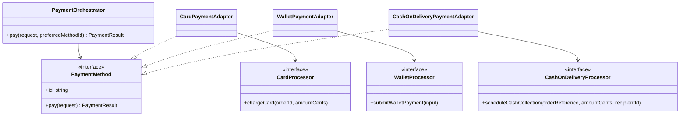
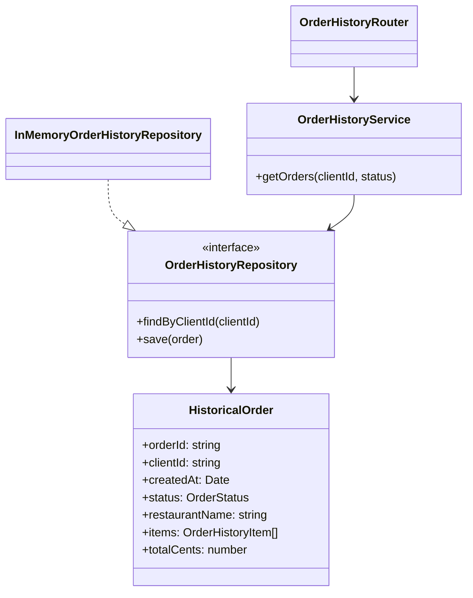

# US04 – Paiement et US09 – Historique des commandes

Ces fonctionnalités sont développées dans des modules autonomes. Elles ne
modifient ni `src/app.ts`, ni les modèles partagés, ni les fichiers des US01,
US02, US03, US05, US06, US07 et US08.

## US04 – Moyens de paiement

### Problème et conception

Les fournisseurs de paiement ont des API et formats de résultats différents,
alors que le cas d'usage doit pouvoir choisir un moyen sans connaître ces
détails.

- **Adapter** : chaque `*PaymentAdapter` traduit le contrat de paiement commun
  vers la signature propre de son fournisseur et normalise sa réponse.
- **Strategy** : chaque moyen réalise le même port `PaymentMethod`; la liste
  ordonnée injectée au `PaymentOrchestrator` configure les options et leur
  priorité.
- **Architecture hexagonale** : le contrat et l'orchestration se trouvent dans
  le module applicatif; fournisseurs et adaptateurs sont au bord du système.
  Le cœur ne dépend pas des classes de fournisseur.

`PaymentOrchestrator.pay` tente le moyen préféré s'il est configuré, puis suit
l'ordre configuré. Un résultat `declined` est un refus métier et termine le
flux sans fallback. Un `ProviderUnavailableError` représente une indisponibilité
connue avant traitement; l'adaptateur la transforme en `PaymentTechnicalError`
réessayable et le moyen suivant peut être tenté. Les erreurs techniques dont
l'issue est incertaine ne sont pas réessayées. Le premier résultat accepté
termine également immédiatement le flux.

### Classes et dépendances

- `PaymentRequest`, `PaymentResult`, `PaymentMethod` : contrat de l'application.
- `PaymentOrchestrator` : sélection, ordre configurable et politique de
  fallback.
- `SimulatedCardProcessor`, `SimulatedWalletProcessor`,
  `SimulatedCashOnDeliveryProcessor` : trois fournisseurs simulés, avec des
  signatures volontairement différentes.
- `CardPaymentAdapter`, `WalletPaymentAdapter`,
  `CashOnDeliveryPaymentAdapter` : adaptation et normalisation.
- `createDefaultPaymentOrchestrator` : assemblage des implémentations simulées.
- `createPaymentRouter` : route HTTP construite par injection, sans
  enregistrement global automatique.



### Endpoint et intégration

Le routeur expose `POST /` et s'attend à être monté sous `/payments`.

```http
POST /payments
Content-Type: application/json

{
  "orderId": "order-123",
  "clientId": "client-42",
  "amountCents": 2590,
  "preferredMethodId": "wallet"
}
```

Succès (`200`) :

```json
{
  "status": "accepted",
  "methodId": "wallet",
  "transactionId": "wallet-order-123"
}
```

Refus métier (`402`) : `status: "declined"` et une raison. Aucun fallback n'est
fait dans ce cas. Si tous les fournisseurs échouent de façon sûrement
réessayable, l'endpoint répond `503` avec la liste des moyens indisponibles.
Les requêtes invalides et le moyen préféré inconnu répondent `400`.

Pour intégrer, ajouter dans `app.ts` (à effectuer par l'équipe lors de
l'intégration) :

```ts
import { createDefaultPaymentOrchestrator } from "@/payment/create-default-payment-orchestrator";
import { createPaymentRouter } from "@/payment/payment.routes";

app.use(
  "/payments",
  createPaymentRouter(createDefaultPaymentOrchestrator())
);
```

Le montant est exprimé en centimes et doit provenir d'une commande validée.
L'endpoint de paiement ne persiste pas la commande ni l'état de paiement et ne
vérifie pas encore l'identité du client. Lier le paiement à la création de
commande et ajouter idempotence/persistance sont des décisions d'intégration
requises avant une mise en production; il ne s'agit pas d'une intégration
bancaire.

## US09 – Historique des commandes

### Repository, consultation et extensibilité

`OrderHistoryRepository` est le port de lecture/écriture utilisé par
`OrderHistoryService`. `InMemoryOrderHistoryRepository` en est l'implémentation
initiale, qui copie les données pour ne pas exposer son état interne. Le service
ne connaît ni `Map` ni le stockage. Une implémentation SQL pourra remplacer le
repository en respectant le même contrat, sans réécrire le service ou la route.

Le modèle local `HistoricalOrder` est indépendant de `Order` dans
`src/mock.model.ts` : il conserve identifiant de commande et client, date,
statut, enseigne, articles et total en centimes. Le service filtre
optionnellement par statut puis trie par date décroissante.



### Endpoint et intégration

Le routeur se monte sous `/clients` et expose
`GET /:clientId/orders`. Le filtre `status` est facultatif et doit appartenir à
la liste exportée `ORDER_STATUSES`.

```http
GET /clients/client-42/orders?status=delivered
```

```json
{
  "orders": [
    {
      "orderId": "order-123",
      "clientId": "client-42",
      "createdAt": "2026-03-01T10:00:00.000Z",
      "status": "delivered",
      "restaurantName": "Da Michele",
      "items": [
        { "name": "Margherita", "quantity": 1, "unitPriceCents": 900 }
      ],
      "totalCents": 900
    }
  ]
}
```

L'endpoint renvoie `200` et une liste vide si le client n'a pas d'historique;
un statut invalide renvoie `400`.

Pour enregistrer les routeurs (modification d'intégration à faire par l'équipe,
pas appliquée ici) :

```ts
import { InMemoryOrderHistoryRepository } from "@/order-history/in-memory-order-history.repository";
import { createOrderHistoryRouter } from "@/order-history/order-history.routes";
import { OrderHistoryService } from "@/order-history/order-history.service";

const orderHistoryService = new OrderHistoryService(
  new InMemoryOrderHistoryRepository()
);
app.use("/clients", createOrderHistoryRouter(orderHistoryService));
```

Le dépôt en mémoire commence vide. Il faut relier sa méthode `save` au flux de
création/validation de commandes lors d'une évolution ultérieure; ce flux ne
peut pas être ajouté ici sans modifier des fichiers partagés appartenant à
d'autres US. Pour passer à une base de données, créer un nouvel adaptateur
implémentant `OrderHistoryRepository` puis l'injecter au même service. Les
statuts et le format du snapshot devront être harmonisés avec le futur modèle
de commande commun.

## Vérification et limites

Les tests dédiés couvrent les trois adaptateurs, la sélection, le fallback
technique, l'absence de fallback après refus ou succès, l'épuisement des moyens,
le tri et filtre d'historique, l'isolation client et les routes. Les simulations
ne réalisent aucun paiement et l'historique n'est pas durable. L'authentification,
l'idempotence et l'intégration avec la future source de commandes ne sont pas
fournies.
